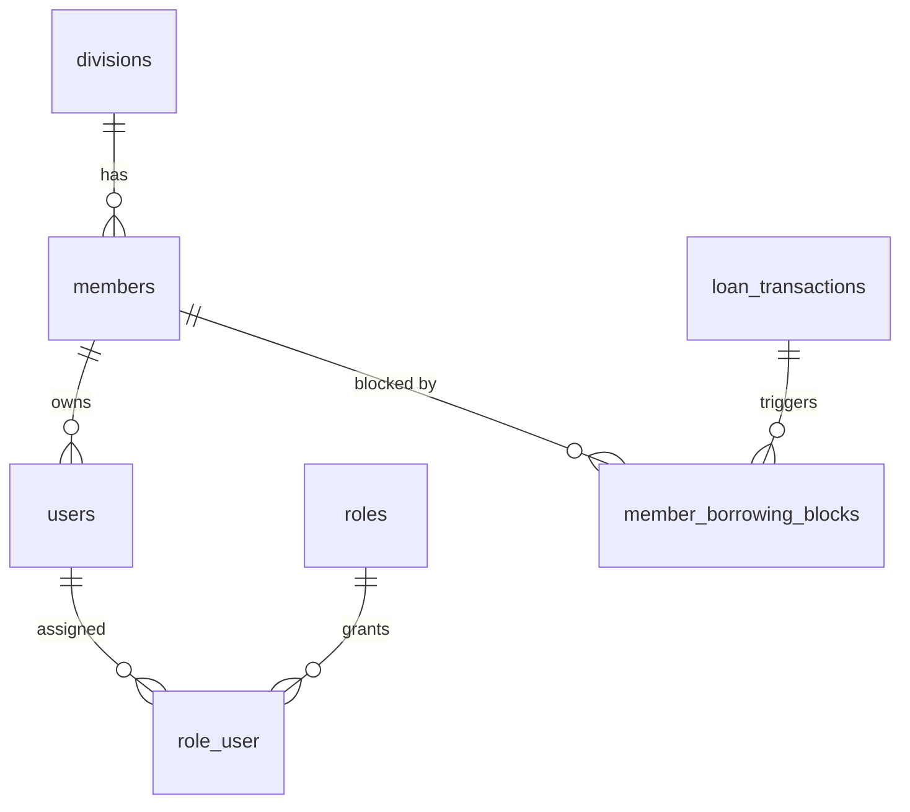
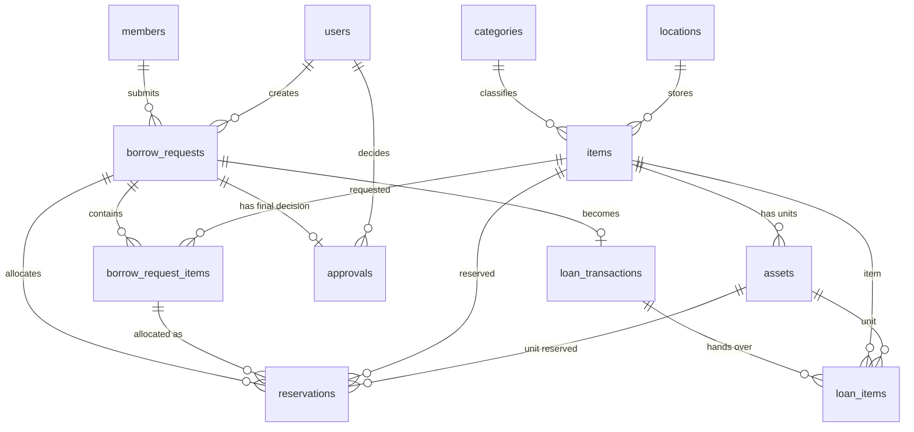
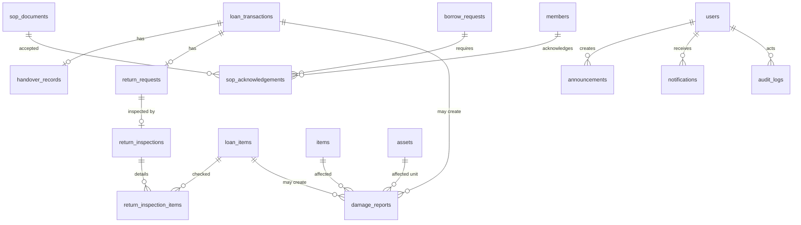

# ENT Inventory — Technical Design & ERD

**Status:** Draft untuk approval  
**Tanggal:** 9 November 2026  
**Acuan:** `PRD.md` v0.2  
**Pemilik:** UKM Jurnalistik / ENT  
**Cakupan:** MVP (P0), dengan catatan untuk P1

---

## 1. Ringkasan

ENT Inventory adalah aplikasi web modular monolith untuk mengelola inventaris, pengajuan peminjaman, approval, reservasi, serah terima berbasis QR, pengembalian, inspeksi, overdue, dan audit log.

Dokumen ini menerjemahkan PRD menjadi:

- keputusan arsitektur dan stack;
- model data + ERD;
- aturan domain yang harus ditegakkan backend;
- urutan implementasi;
- strategi pengujian;
- keputusan yang masih perlu disahkan pengurus.

**Prinsip utama:** frontend bukan sumber otoritas. Semua aturan stok, approval, blokir, QR, dan status transaksi divalidasi ulang di backend di dalam database transaction.

---

## 2. Tujuan, Non-goals, dan Anti-goals

### 2.1 Tujuan MVP

1. Satu sumber data inventaris dan lokasi penyimpanan.
2. Katalog yang bisa dicari/difilter anggota.
3. Pengajuan Terjadwal/Mendadak dengan validasi H-2 dan SOP.
4. Approval oleh Admin/Korlab atau WM, satu keputusan final.
5. Reservasi yang mencegah double booking.
6. Serah terima dengan QR dan verifikasi Admin/Korlab.
7. Pengembalian dengan inspeksi kondisi.
8. Overdue otomatis memblokir identitas anggota.
9. Audit log untuk keputusan dan perubahan penting.
10. Dashboard dan pengumuman internal.

### 2.2 Non-goals MVP

- Akuntansi, procurement, invoice, atau pembukuan.
- Aplikasi native Android/iOS.
- Tanda tangan elektronik tersertifikasi.
- Denda uang otomatis.
- Integrasi otomatis ke sistem keanggotaan kampus.
- Notifikasi eksternal (WA/email) — P1.
- Ekspor PDF/Excel — P1.

### 2.3 Anti-goals

Sistem dinyatakan gagal jika:

- barang bisa keluar tanpa approval dan checkout Admin/Korlab;
- satu unit bisa dipinjam dua anggota pada periode yang sama;
- anggota overdue masih bisa mengajukan lewat akun lain;
- approver bisa menyetujui pengajuannya sendiri;
- barang rusak/hilang otomatis kembali tersedia;
- audit log bisa diubah/dihapus lewat aplikasi.

---

## 3. Batasan dan Asumsi

| Batasan | Keputusan |
|---|---|
| Skala | Puluhan anggota, ratusan unit aset; tidak butuh microservices. |
| Tim | Kecil; satu aplikasi, satu deployment, satu database. |
| Hosting | VPS dengan Docker; PostgreSQL tersedia. |
| Zona waktu | `Asia/Jakarta` untuk perhitungan tanggal; database menyimpan UTC (`timestamptz`). |
| Bahasa UI | Bahasa Indonesia; nilai enum database dalam bahasa Inggris. |
| Auth | NRP/username + password; bukan SSO kampus. |
| QR | Kamera perangkat + input manual sebagai fallback. |
| File | Private local storage dulu; S3-compatible saat diperlukan. |
| Redis | Tidak wajib untuk MVP; queue memakai driver database. |

**Asumsi yang perlu dikonfirmasi:** stack Laravel + Vue 3 + Inertia + PostgreSQL mengikuti §12.2 PRD dan belum ada constraint hosting yang membatalkannya.

---

## 4. Pendekatan Arsitektur

### 4.1 Alternatif yang dipertimbangkan

| Pendekatan | Trade-off | Keputusan |
|---|---|---|
| **Modular monolith**: Laravel + Inertia + Vue | Satu deploy, transaksi DB mudah, auth/policy/queue/scheduler sudah ada, cocok untuk tim kecil. | **Dipilih** |
| API terpisah + SPA | Perlu dua deploy, CORS, token/session, duplikasi kontrak API. Tidak ada manfaat pada skala ini. | Ditolak |
| Microservices | Overhead operasional besar; transaksi lintas service menjadi rumit. | Ditolak |
| Blade + Livewire | Lebih sedikit JavaScript, tetapi PRD memilih Vue/Inertia dan interaksi QR/katalog lebih nyaman di Vue. | Tidak dipilih |
| Low-code/no-code | Sulit menegakkan locking, audit append-only, dan aturan stok yang kompleks. | Ditolak |

### 4.2 Stack final

| Lapisan | Pilihan |
|---|---|
| Backend | Laravel versi stabil yang didukung saat implementasi |
| Frontend | Vue 3 + Inertia.js |
| Styling | Tailwind CSS (sesuai starter kit Laravel) |
| Database | PostgreSQL 16+ |
| Auth | Laravel starter kit (Vue/Inertia), dikustomisasi ke username/NRP |
| RBAC | Tabel `roles` + `role_user` + Laravel Policies/Gates (tanpa package tambahan) |
| QR generate | `simplesoftwareio/simple-qrcode` |
| QR scan | `vue-qrcode-reader` + input manual |
| Testing | PHPUnit 12 (feature/unit) + Playwright (alur kritis) |
| Queue | Database driver; worker container |
| Scheduler | Laravel scheduler via container/cron |
| Deployment | Docker Compose + Nginx + PHP-FPM + PostgreSQL |
| Backup | `pg_dump` harian + backup storage privat |

**Catatan:** Redis, Horizon, dan object storage eksternal ditunda sampai ada kebutuhan nyata.

### 4.3 Struktur kode

```
app/
  Actions/
    Auth/
    Members/
    Inventory/
    Borrowing/
    Approval/
    Handover/
    Returns/
    Overdue/
    Announcements/
    Audit/
  Enums/
  Http/
    Controllers/
    Middleware/
    Requests/
  Models/
  Policies/
  Services/
    AvailabilityService.php
    QrCodeService.php
    ReferenceNumberService.php
    AuditLogger.php
  Support/
database/
  migrations/
  seeders/
resources/js/
  Pages/
    Auth/
    User/
    Admin/
    Wm/
  Components/
  Layouts/
routes/
  web.php
  admin.php
  wm.php
tests/
  Feature/
  Unit/
```

Aturan:

- Controller hanya validasi request, memanggil Action, dan mengembalikan response.
- Business rule berada di Action/Service, bukan di controller atau Vue.
- Setiap Action kritis membungkus perubahan dalam `DB::transaction()`.
- Audit ditulis di dalam transaksi yang sama dengan perubahan domain, kecuali event login.

---

## 5. Identitas, Akun, dan Hak Akses

### 5.1 Model identitas

- `members` = identitas anggota. NRP unik. Satu NRP = satu anggota.
- `users` = akun login. Selalu terhubung ke satu `member_id`.
- Satu anggota boleh punya lebih dari satu akun:
  - akun personal (role `user`) dengan username = NRP;
  - akun administratif (role `admin_korlab` atau `wm`) dengan username terpisah.
- Login form menerima **NRP / Username**.
- Self-approval dibandingkan lewat `members.id`, bukan `users.id`.

### 5.2 Role

| Role | Kewenangan utama |
|---|---|
| `user` | Katalog, pengajuan, pembatalan, pengembalian, riwayat pribadi, pengumuman. |
| `admin_korlab` | Approval, inventaris, QR checkout, verifikasi pengembalian, pengumuman, riwayat. |
| `wm` | Approval, manajemen anggota, monitoring, audit, anggota terblokir. |

Aturan tambahan:

- Approval: `admin_korlab` **atau** `wm`.
- Checkout dan verifikasi pengembalian: hanya `admin_korlab`.
- Manajemen anggota dan audit: hanya `wm`.
- Akun administratif tidak diberi role `user`; pengurus yang ingin meminjam memakai akun personal terpisah.
- Middleware route + Policy memeriksa role dan kepemilikan data.

### 5.3 Status akun dan anggota

| Field | Nilai | Efek |
|---|---|---|
| `users.status` | `active`, `inactive` | `inactive` tidak bisa login. |
| `members.membership_status` | `active`, `inactive` | `inactive` tetap bisa login dan melihat riwayat, tetapi tidak bisa mengajukan. |
| `members.borrowing_status` | `eligible`, `borrowing_blocked` | `borrowing_blocked` tidak bisa mengajukan, tetapi tetap bisa login dan mengajukan pengembalian. |

Menonaktifkan anggota tidak menghapus user, transaksi, atau kewajiban yang belum selesai.

### 5.4 Provisioning akun

- WM membuat anggota dan akun personal dengan password awal.
- WM juga membuat akun administratif, memberi/mencabut role, mereset password, dan menonaktifkan akun.
- Guard: WM tidak bisa menonaktifkan akunnya sendiri atau menghapus WM aktif terakhir.
- `users.must_change_password = true` sampai pengguna mengganti password.
- Reset password mandiri adalah P1; MVP memakai reset oleh WM.
- Password disimpan dengan hash Laravel (Argon2id/bcrypt).

---

## 6. Model Data dan ERD

### 6.1 Prinsip model data

1. **Tidak ada hard delete** untuk data yang sudah direferensikan transaksi. Gunakan status `inactive`.
2. **Stok dihitung** dari stok fisik + reservasi + pinjaman aktif + laporan kerusakan terbuka; tidak ada counter `available` yang bisa drift.
3. **Reservasi bersifat time-bound**. Status fisik aset tidak diubah menjadi `reserved` untuk booking masa depan.
4. **Satu pengajuan = maksimal satu approval final** dan **satu loan transaction**.
5. **Checkout menghasilkan `loan_items` aktual**, bukan sekadar menyalin rencana.
6. **Semua waktu** memakai `timestamptz`; perhitungan H-2 memakai zona `Asia/Jakarta`.
7. **Uang** memakai `numeric(14,2)`, bukan float.

### 6.2 ERD — Identitas dan akses



### 6.3 ERD — Inventaris dan peminjaman



### 6.4 ERD — Handover, return, damage, dan pendukung



### 6.5 Kamus tabel

#### Identitas dan akses

| Tabel | Kolom penting | Constraint / catatan |
|---|---|---|
| `divisions` | `id`, `name`, `code`, timestamps | `name`, `code` unik. |
| `members` | `id`, `member_code`, `name`, `nrp`, `division_id`, `generation`, `position`, `notes`, `membership_status`, `borrowing_status` | `member_code`, `nrp` unik; FK divisi `restrict`. |
| `users` | `id`, `member_id`, `username`, `password`, `status`, `must_change_password`, `last_login_at` | `username` unik; FK member `restrict`; akun admin tetap terhubung ke member. |
| `roles` | `id`, `name` | `name` unik: `user`, `admin_korlab`, `wm`. |
| `role_user` | `user_id`, `role_id` | PK gabungan; user bisa punya lebih dari satu role. |
| `member_borrowing_blocks` | `id`, `member_id`, `loan_transaction_id`, `reason`, `started_at`, `ended_at`, `released_by_user_id`, `notes` | Partial unique: satu blok aktif per loan. `ended_at IS NULL` = aktif. |

#### Inventaris

| Tabel | Kolom penting | Constraint / catatan |
|---|---|---|
| `categories` | `id`, `name`, `description` | `name` unik. |
| `locations` | `id`, `name`, `code`, `description` | `name`, `code` unik. |
| `items` | `id`, `code`, `name`, `category_id`, `tracking_method`, `quantity_total`, `price`, `acquired_at`, `status`, `location_id`, `qr_token`, `notes` | `code` unik; `qr_token` unik; `tracking_method` = `serialized`/`quantity`; `quantity_total` wajib untuk quantity, null untuk serialized. |
| `assets` | `id`, `item_id`, `asset_code`, `serial_number`, `qr_token`, `condition`, `status`, `notes` | `asset_code`, `qr_token` unik; `serial_number` unik jika diisi; status fisik: `available`, `borrowed`, `damaged`, `maintenance`, `lost`, `inactive`. |

**Keputusan penting:** `reserved` tidak disimpan sebagai status fisik aset. Reservasi masa depan disimpan di `reservations`; jika status aset dijadikan `reserved`, unit yang dipesan minggu depan akan salah terlihat tidak tersedia hari ini. UI tetap menampilkan label "dipesan" dari query reservasi.

#### Pengajuan, approval, dan reservasi

| Tabel | Kolom penting | Constraint / catatan |
|---|---|---|
| `borrow_requests` | `id`, `reference_no`, `member_id`, `created_by_user_id`, `category`, `pickup_at`, `return_at`, `usage_location`, `purpose`, `notes`, `status`, `submitted_at`, `cancelled_at`, `cancellation_reason` | `reference_no` unik; `return_at > pickup_at`; status: `pending_approval`, `approved`, `rejected`, `cancelled`. |
| `borrow_request_items` | `id`, `borrow_request_id`, `item_id`, `quantity`, `notes` | `quantity > 0`; unique `(borrow_request_id, item_id)`. |
| `approvals` | `id`, `borrow_request_id`, `approver_user_id`, `approver_member_id`, `approver_role`, `decision`, `notes`, `decided_at` | **unique `borrow_request_id`**; `notes` wajib saat `rejected`; `approver_member_id` disimpan untuk audit dan self-approval. |
| `reservations` | `id`, `borrow_request_id`, `borrow_request_item_id`, `item_id`, `asset_id`, `quantity`, `quantity_fulfilled`, `start_at`, `end_at`, `status` | status: `active`, `fulfilled` (quantity_fulfilled > 0), `released` (quantity_fulfilled = 0); serialized: `asset_id` wajib, `quantity = 1`; quantity: `asset_id` null. |
| `loan_transactions` | `id`, `borrow_request_id`, `member_id`, `status`, `checked_out_at`, `due_at`, `returned_at`, `completed_at`, `overdue_at`, `cancelled_at`, `cancellation_reason` | unique `borrow_request_id`; status: `reserved`, `borrowed`, `overdue`, `return_pending_verification`, `completed`, `cancelled`. |

Constraint anti-double-booking untuk serialized:

```sql
CREATE EXTENSION IF NOT EXISTS btree_gist;

ALTER TABLE reservations
  ADD CONSTRAINT reservations_asset_no_overlap
  EXCLUDE USING gist (
    asset_id WITH =,
    tstzrange(start_at, end_at, '[)') WITH &&
  )
  WHERE (asset_id IS NOT NULL AND status = 'active');
```

Untuk quantity-tracked, exclusion constraint tidak bisa menjumlahkan kuantitas. Karena itu:

- lock baris `items` (`SELECT ... FOR UPDATE`) saat approval/reservasi;
- hitung total reservasi + pinjaman aktif yang overlap di dalam transaksi;
- tolak jika melebihi stok tersedia.

#### Handover, return, dan damage

| Tabel | Kolom penting | Constraint / catatan |
|---|---|---|
| `loan_items` | `id`, `loan_transaction_id`, `item_id`, `asset_id`, `quantity`, `condition_out`, `notes` | serialized: `asset_id` wajib, `quantity = 1`; quantity: `asset_id` null; kondisi akhir dicatat di `return_inspection_items`. |
| `handover_records` | `id`, `loan_transaction_id`, `officer_user_id`, `borrower_member_id`, `handed_at`, `checklist`, `scan_results`, `borrower_confirmation_method`, `borrower_confirmed_at`, `notes` | unique `loan_transaction_id`; `checklist`/`scan_results` JSONB. |
| `return_requests` | `id`, `loan_transaction_id`, `requested_by_user_id`, `requested_at`, `status`, `notes`, `cancelled_reason`, `verified_at` | partial unique `(loan_transaction_id) WHERE status = 'pending'`; status: `pending`, `verified`, `cancelled`; request yang dibatalkan boleh diajukan ulang. |
| `return_inspections` | `id`, `return_request_id`, `officer_user_id`, `inspected_at`, `notes`, `photos` | unique `return_request_id`; `photos` JSONB berisi path privat. |
| `return_inspection_items` | `id`, `return_inspection_id`, `loan_item_id`, `condition`, `quantity_returned`, `notes` | boleh lebih dari satu baris per loan item (kondisi campuran); `quantity_returned > 0`; total per loan item ≤ quantity loan item. |
| `damage_reports` | `id`, `loan_transaction_id`, `loan_item_id`, `item_id`, `asset_id`, `member_id`, `type`, `quantity`, `description`, `status`, `resolution`, `resolution_notes`, `reported_by_user_id`, `reported_at`, `resolved_by_user_id`, `resolved_at` | type: `damage`, `loss`, `incomplete`, `maintenance`; status: `open`, `resolved`; resolution: `repaired`, `written_off` (null saat open). |

#### Pendukung

| Tabel | Kolom penting | Constraint / catatan |
|---|---|---|
| `sop_documents` | `id`, `version`, `title`, `content`, `effective_at`, `is_active`, `created_by_user_id` | `version` unik; hanya satu SOP aktif. |
| `sop_acknowledgements` | `id`, `member_id`, `borrow_request_id`, `sop_document_id`, `accepted_at`, `ip_address` | unique `(borrow_request_id, sop_document_id)`. |
| `announcements` | `id`, `title`, `content`, `status`, `published_at`, `created_by_user_id`, `updated_by_user_id` | status: `draft`, `published`; konten plain text/markdown aman, bukan HTML mentah. |
| `notifications` | `id`, `user_id`, `type`, `title`, `body`, `data`, `read_at`, `created_at` | index `(user_id, read_at)`. |
| `audit_logs` | `id`, `actor_user_id`, `actor_member_id`, `actor_role`, `action`, `entity_type`, `entity_id`, `before`, `after`, `metadata`, `ip_address`, `user_agent`, `created_at` | append-only; tanpa `updated_at`/`deleted_at`; tidak ada route update/delete. |

### 6.6 Index minimum

```sql
-- katalog
CREATE INDEX items_category_status_idx ON items (category_id, status);
CREATE INDEX items_name_trgm_idx ON items USING gin (name gin_trgm_ops); -- opsional, jika ILIKE mulai lambat

-- ketersediaan
CREATE INDEX reservations_item_period_idx ON reservations (item_id, start_at, end_at, status);
CREATE INDEX reservations_request_idx ON reservations (borrow_request_id);
CREATE INDEX assets_item_status_idx ON assets (item_id, status);

-- antrean operasional
CREATE INDEX borrow_requests_queue_idx ON borrow_requests (status, category, submitted_at);
CREATE INDEX loan_transactions_status_due_idx ON loan_transactions (status, due_at);
CREATE INDEX loan_transactions_member_idx ON loan_transactions (member_id, status);
CREATE INDEX return_requests_status_idx ON return_requests (status);
CREATE UNIQUE INDEX return_requests_one_pending_idx ON return_requests (loan_transaction_id) WHERE status = 'pending';
CREATE UNIQUE INDEX member_blocks_active_loan_idx ON member_borrowing_blocks (loan_transaction_id) WHERE ended_at IS NULL;
CREATE INDEX member_blocks_member_active_idx ON member_borrowing_blocks (member_id) WHERE ended_at IS NULL;

-- audit
CREATE INDEX audit_logs_entity_idx ON audit_logs (entity_type, entity_id, created_at);
CREATE INDEX audit_logs_actor_idx ON audit_logs (actor_user_id, created_at);
```

---

## 7. Aturan Domain dan Invariant

### 7.1 Pengajuan

- Anggota hanya boleh mengajukan jika:
  - `members.membership_status = active`;
  - tidak ada `member_borrowing_blocks` aktif;
  - tidak ada loan overdue yang belum selesai (dicek ulang saat submit, bukan hanya mengandalkan scheduler).
- `created_by_user_id` harus milik `member_id` yang sama dan memiliki role `user`.
- Minimal satu barang; quantity > 0; barang harus `active`.
- `return_at > pickup_at`.
- Kategori `scheduled`:
  - `pickup_at` dalam zona `Asia/Jakarta` harus ≥ hari ini + 2 hari kalender (default).
- Kategori `urgent`:
  - dikecualikan dari H-2;
  - wajib punya `purpose`/alasan;
  - masuk antrean prioritas.
- SOP:
  - user wajib menyetujui SOP aktif;
  - `sop_acknowledgements` dibuat bersamaan dengan submit;
  - versi SOP yang disetujui tersimpan.
- Nomor referensi dibuat setelah insert: `REQ-YYYYMMDD-{id padded}`. Unik.

### 7.2 Approval

- Hanya `admin_korlab` atau `wm`.
- Approver tidak boleh memiliki `member_id` yang sama dengan `borrow_requests.member_id`, termasuk lintas akun.
- `borrow_request` dikunci `FOR UPDATE`.
- Hanya status `pending_approval` yang bisa diputuskan.
- Satu approval final per pengajuan; unique constraint `approvals.borrow_request_id` menjadi pengaman terakhir.
- Penolakan wajib memiliki `notes`.
- Dalam satu transaksi:
  1. insert `approvals`;
  2. update `borrow_requests.status`;
  3. buat `loan_transactions` berstatus `reserved`;
  4. buat `reservations`;
  5. tulis audit log.
- Jika reservasi gagal, seluruh approval dibatalkan (tidak ada approval tanpa reservasi).

### 7.3 Reservasi dan ketersediaan

**Serialized**

- Ketersediaan dihitung **per periode**, bukan dari status hari ini. Unit yang sedang `borrowed` tetap boleh dipesan untuk periode setelah pinjamannya berakhir, dengan syarat pinjaman tersebut tidak `overdue`/`return_pending_verification` dan `due_at`-nya ≤ `pickup_at` yang diminta.
- Saat approval, sistem memilih unit yang tidak punya reservasi/pinjaman overlap pada periode yang diminta. Status `damaged`, `maintenance`, `lost`, dan `inactive` selalu ditolak.
- Setiap unit menjadi satu baris `reservations` dengan `asset_id`.
- Exclusion constraint mencegah overlap reservasi aktif.
- Pinjaman aktif dicek di aplikasi di dalam lock yang sama; exclusion constraint hanya menjaga antar-reservasi.
- Katalog menampilkan ketersediaan periode setelah tanggal dipilih, bukan sekadar status fisik hari ini.

**Quantity-tracked**

- Stok tersedia untuk periode =
  `quantity_total`
  − reservasi aktif yang overlap
  − pinjaman aktif yang overlap
  − pinjaman `overdue`/`return_pending_verification` yang belum selesai (karena barang belum terverifikasi kembali)
  − laporan damage/loss/maintenance terbuka.
- Approval melakukan `SELECT ... FOR UPDATE` pada baris `items`.
- Jika total melebihi stok, tolak dengan pesan jumlah tersedia.
- Perubahan `quantity_total` tidak boleh membuat stok tersedia negatif; validasi terhadap laporan damage/loss/maintenance terbuka.

**Umum**

- Reservasi `active` dilepas (`released`) saat pengajuan dibatalkan/kedaluwarsa.
- Reservasi menjadi `fulfilled` saat checkout; stok pinjaman dihitung dari `loan_items` + transaksi aktif.
- Tidak ada double booking; tidak ada stok minus.

### 7.4 Checkout / serah terima

Prasyarat:

- `loan_transactions.status = reserved`;
- belum melewati batas pengambilan;
- pengajuan berstatus `approved`;
- minimal satu unit/quantity benar-benar diserahkan.

Alur backend:

1. Admin memindai QR atau memasukkan token manual.
2. Endpoint scan hanya membaca dan memvalidasi; tidak mengubah status.
3. Validasi token:
   - token ada dan unik;
   - unit/barang termasuk item yang dipesan pada transaksi ini;
   - untuk serialized: unit `available` secara fisik, bukan `damaged`/`maintenance`/`lost`/`inactive`, dan tidak punya reservasi/pinjaman lain yang overlap dengan periode pinjaman ini;
   - untuk quantity: jumlah aktual ≤ jumlah reserved.
4. Admin mengisi jumlah/unit aktual, kondisi awal, checklist, dan konfirmasi peminjam.
5. Dalam satu transaksi:
   - lock transaksi + unit/barang;
   - buat `loan_items`;
   - buat `handover_records`;
   - reservasi yang terpakai: isi `quantity_fulfilled`, status `fulfilled`; yang tidak diserahkan sama sekali: status `released`;
   - ubah aset serialized menjadi `borrowed`;
   - ubah transaksi menjadi `borrowed`;
   - tulis audit log.
6. Konfirmasi penerimaan:
   - default MVP: Admin mencatat konfirmasi on-site saat peminjam hadir (`borrower_confirmation_method = on_site`);
   - konfirmasi mandiri dari akun user bersifat opsional dan tidak memblokir operasional.

**Partial checkout dan penukaran unit**

- Partial checkout diperbolehkan: jumlah aktual boleh lebih kecil dari reserved. Untuk quantity, `quantity_fulfilled` mencatat jumlah aktual dan selisih `quantity - quantity_fulfilled` menjadi shortfall yang tidak dialokasikan lagi. Untuk serialized, reservasi unit yang tidak diserahkan menjadi `released`. User diberi notifikasi dan audit log dicatat. Minimal satu unit/quantity harus diserahkan.
- Untuk serialized, jika unit yang direservasi rusak/hilang saat pengambilan, Admin boleh menukar ke unit lain dari item yang sama selama unit pengganti `available` dan tidak overlap dengan reservasi/pinjaman lain. Reservasi unit lama dilepas dan unit pengganti dicatat `fulfilled` dalam transaksi checkout yang sama.
- Untuk quantity, kekurangan jumlah diperlakukan sebagai partial checkout dan sisanya dilepas.
- Penukaran unit dan partial checkout wajib memiliki catatan alasan.

QR tidak pernah mengubah status sendiri. Scan selalu butuh sesi Admin/Korlab.

### 7.5 Pengembalian dan inspeksi

- User dapat mengajukan pengembalian saat transaksi `borrowed` atau `overdue`.
- Setelah request dibuat, status transaksi menjadi `return_pending_verification`; stok belum kembali.
- Admin/Korlab memeriksa setiap `loan_item`. Satu `loan_item` quantity boleh dipecah menjadi beberapa baris inspeksi dengan kondisi berbeda (misalnya 8 baik + 2 rusak); total `quantity_returned` tidak boleh melebihi quantity loan item.
- Kondisi:
  - `good`: unit/quantity kembali tersedia;
  - `damaged`: aset menjadi `damaged` atau laporan damage terbuka; tidak tersedia;
  - `incomplete`: tidak tersedia sampai diselesaikan;
  - `lost`: aset menjadi `lost` atau laporan loss terbuka; tidak tersedia.
- Transaksi hanya boleh `completed` jika total `quantity_returned` per loan item sama dengan quantity loan item, dan setiap baris kondisi punya tindak lanjut (good, damage report, atau resolusi).
- Jika user mengajukan return tetapi barang tidak diserahkan, Admin dapat membatalkan return request dengan alasan; transaksi kembali ke `overdue` jika `overdue_at` terisi, selain itu ke `borrowed`.
- Partial return tetap P1. MVP menyelesaikan seluruh transaksi, tetapi inspeksi per item dan kondisi campuran sudah didukung.

**Resolusi kerusakan/kehilangan (P0)**

- Admin/Korlab dapat membuat damage report dari inspeksi pengembalian atau langsung dari detail inventaris (stock opname/kerusakan di lokasi).
- Laporan `open` mengurangi ketersediaan quantity dan/atau menandai aset tidak tersedia.
- Resolusi:
  - `repaired`: laporan ditutup; aset kembali `available`; quantity kembali tersedia.
  - `written_off`: laporan ditutup; `quantity_total` dikurangi permanen (quantity-tracked) atau aset menjadi `lost` (serialized).
- Penggantian unit baru dicatat sebagai penambahan stok terpisah; tidak ada resolusi `replaced` di MVP.
- Setiap resolusi mencatat pelaku, waktu, catatan, dan audit log.

### 7.6 Overdue dan pemblokiran

Definisi overdue:

```text
due_at < now()
AND loan_transactions.status IN ('borrowed', 'return_pending_verification')
AND overdue_at IS NULL
```

Transaksi `reserved` tidak pernah menjadi overdue. Jika barang tidak diambil, reservasi kedaluwarsa dan pengajuan dibatalkan; anggota tidak diblokir untuk barang yang tidak pernah diterima.

- Scheduler berjalan setiap 10 menit:
  - transaksi `borrowed` yang lewat tenggat → status `overdue`, isi `overdue_at`;
  - transaksi `return_pending_verification` yang lewat tenggat → tetap statusnya, isi `overdue_at`;
  - buat `member_borrowing_blocks` aktif per transaksi overdue (idempotent).
- Saat user submit pengajuan, backend menjalankan pengecekan overdue yang sama secara sinkron. Keterlambatan scheduler tidak boleh menjadi celah.
- Blokir berlaku pada `members.id`, bukan `users.id`.
- Anggota tetap bisa login, melihat riwayat, dan mengajukan pengembalian.
- Saat transaksi selesai:
  - tutup blok untuk transaksi tersebut (`ended_at`);
  - jika tidak ada blok aktif lain, ubah `members.borrowing_status = eligible`;
  - tulis audit log.
- Pembukaan blok manual tidak tersedia di MVP.

### 7.7 Pembatalan

- `pending_approval`: user boleh membatalkan.
- `approved` dan belum checkout: user boleh membatalkan; Admin/Korlab juga boleh membatalkan dengan alasan operasional (misalnya barang rusak atau kegiatan batal). Reservasi dilepas, transaksi menjadi `cancelled`, dan audit log dicatat.
- Setelah checkout: pembatalan tidak boleh; gunakan alur pengembalian.
- Reservasi yang tidak diambil sampai akhir tanggal pengambilan dibatalkan otomatis oleh scheduler, reservasi dilepas, dan pengajuan menjadi `cancelled` dengan alasan kedaluwarsa.
- Semua pembatalan mencatat pelaku, waktu, dan alasan.

### 7.8 Audit

Audit log wajib untuk:

- login sukses/gagal yang relevan;
- perubahan anggota, role, status, divisi;
- pembuatan/perubahan/nonaktif barang dan perubahan stok;
- submit/cancel pengajuan;
- approval/rejection;
- pembuatan/pelepasan reservasi;
- scan QR (sukses dan gagal) dan checkout;
- return request, inspeksi, keputusan kondisi, dan resolusi damage/loss;
- perubahan akun, role, reset password, dan penonaktifan akun;
- overdue, blokir, dan pelepasan blokir;
- publikasi pengumuman.

Format minimal: pelaku, role saat itu, aksi, entity, before/after (jika relevan), metadata, waktu, IP/user agent. Jangan pernah menyimpan password, token sesi, atau QR token mentah di audit log.

### 7.9 QR

- Token QR dibuat acak minimal 128-bit (`Str::random(40)`), unik, tanpa NRP/password/data pribadi.
- QR untuk serialized mengarah ke `assets.qr_token`.
- QR untuk quantity mengarah ke `items.qr_token`.
- Scan hanya identifikasi; checkout tetap keputusan Admin/Korlab.
- Token yang tidak dikenal, nonaktif, rusak, hilang, atau bukan bagian pengajuan ditolak dan dicatat.

---

## 8. State Machine

### 8.1 Pengajuan

```text
pending_approval ──approve──> approved ──checkout──> (loan borrowed)
        │                         │
        ├──reject──> rejected     └──cancel/expire──> cancelled
        └──cancel──> cancelled
```

### 8.2 Transaksi pinjaman

```text
reserved ──checkout──> borrowed ──return request──> return_pending_verification ──verify──> completed
    │                       │                                      │
    │                       └──due passed──> overdue ──return request──┘
    └──cancel/expire──> cancelled
```

Catatan: `overdue` hanya berasal dari `borrowed` atau `return_pending_verification`; transaksi `reserved` tidak pernah overdue. Jika return request dibuat setelah overdue, status menjadi `return_pending_verification` tetapi `overdue_at` tetap terisi dan blokir tetap aktif sampai verifikasi selesai.

### 8.3 Reservasi

```text
active ──checkout──> fulfilled
active ──cancel/expire──> released
```

### 8.4 Aset serialized

```text
available ──checkout──> borrowed ──return good──> available
available ──checkout──> borrowed ──return damaged──> damaged
available ──checkout──> borrowed ──return lost──> lost
damaged ──repair──> maintenance ──resolve──> available
```

### 8.5 Return request

```text
pending ──verify──> verified
pending ──admin cancel──> cancelled (transaksi kembali ke borrowed/overdue)
```

---

## 9. Alur Teknis Kunci

### 9.1 Submit pengajuan

```text
POST /peminjaman
  authorize: role user, member active, member eligible
  validate: items, quantity, dates, H-2/urgent, SOP
  DB transaction:
    lock member row
    re-check active blocks + overdue
    create borrow_request (pending_approval)
    create borrow_request_items
    create sop_acknowledgement
    audit log
  commit
  notify user
```

### 9.2 Approval

```text
POST /admin/approval/{request}/approve
  authorize: admin_korlab|wm, approver.member_id != request.member_id
  DB transaction:
    lock borrow_request FOR UPDATE
    assert status pending_approval
    insert approval
    update request approved
    create loan_transaction reserved
    lock items/assets
    create reservations (validate availability)
    audit log
  commit
  notify user
```

### 9.3 Checkout

```text
POST /admin/checkout/{transaction}/scan   -> read-only validation
POST /admin/checkout/{transaction}/confirm
  authorize: admin_korlab
  DB transaction:
    lock loan_transaction FOR UPDATE
    assert status reserved and not expired
    re-validate scanned tokens: same item, physically available, no overlap
    create loan_items (actual quantity/units)
    create handover_record
    used reservations -> fulfilled; remainder -> released (reason required)
    swapped asset: old reservation released, replacement fulfilled
    assets -> borrowed
    transaction -> borrowed
    audit log
  commit
```

### 9.4 Return dan inspeksi

```text
POST /peminjaman-saya/{transaction}/return
  authorize: owner, status borrowed|overdue
  transaction -> return_pending_verification
  create return_request pending

POST /admin/pengembalian/{return}/verify
  authorize: admin_korlab
  DB transaction:
    lock return_request + loan_transaction
    create return_inspection + items (boleh beberapa baris per loan_item)
    for each inspection item:
      good -> asset available / quantity released
      damaged|incomplete|lost -> create damage_report open, asset not available
    transaction -> completed
    close member_borrowing_block for this loan
    if no active blocks -> member eligible
    audit log
  commit

POST /admin/damage/{report}/resolve
  authorize: admin_korlab
  DB transaction:
    lock damage_report
    assert status open
    repaired -> close report; asset available / quantity available again
    written_off -> close report; quantity_total decrement / asset lost
    audit log
  commit
```

### 9.5 Overdue scheduler

```text
every 10 minutes:
  for each loan with status in (borrowed, return_pending_verification)
      and due_at < now and overdue_at is null:
    set overdue_at
    if borrowed: status = overdue
    ensure active block exists for (member, loan)
  reconcile members.borrowing_status
  idempotent: unique active block per loan + overdue_at guard
  reserved transactions are never marked overdue
```

---

## 10. Kebijakan Default MVP

Nilai berikut dipakai sebagai default agar development tidak tertahan. Semua dapat diubah lewat config; keputusan resmi tetap milik pengurus.

| Kebijakan | Default MVP | Alasan |
|---|---|---|
| H-2 | 2 hari kalender | Paling sederhana; tidak butuh kalender hari kerja/hari libur. |
| Jam layanan | Tidak memblokir submit; UI menampilkan 08:00–17:00 | Menghindari validasi jam yang belum disepakati. |
| Durasi maksimal | 7 hari | Cukup untuk kegiatan kampus; config. |
| Maksimal item per pengajuan | 10 baris item | Mencegah penyalahgunaan; config. |
| Pengajuan Mendadak | Alasan wajib; tanpa lampiran | Lampiran bukti adalah P1. |
| Reservasi kedaluwarsa | Akhir tanggal pengambilan (23:59 Asia/Jakarta) | Jelas dan mudah dioperasikan. |
| Pembukaan blokir manual | Tidak ada | Mengikuti aturan otomatis PRD. |
| Kerusakan/kehilangan | Laporan terbuka + resolusi `repaired`/`written_off` | Barang tidak otomatis tersedia. |
| Checkout/return oleh WM | Tidak | Sesuai workflow default PRD. |
| Konfirmasi penerimaan | On-site oleh Admin; konfirmasi akun opsional | Tidak memblokir serah terima di lapangan. |
| Partial checkout | Diperbolehkan; sisa reservasi dilepas | Menyesuaikan kondisi barang di lapangan. |
| Penukaran unit serialized | Diperbolehkan saat checkout dengan alasan | Mengakomodasi unit rusak/hilang saat pengambilan. |
| Ekspor PDF/Excel | Tidak ada di MVP | P1. |
| Partial return | Tidak ada di MVP | P1; model data sudah per item. |

---

## 11. Keamanan

- Password hash Laravel; tidak pernah disimpan/log dalam plaintext.
- Login throttle per kombinasi username + IP; pesan error generik.
- Session regeneration setelah login; cookie `secure`, `httpOnly`, `SameSite=Lax`.
- CSRF protection Laravel untuk semua form.
- Setiap endpoint memakai middleware auth + role + Policy; kepemilikan data diperiksa.
- Self-approval dicek berdasarkan `member_id`.
- Validasi input memakai FormRequest; output di-escape Vue.
- Upload file: MIME whitelist (`jpg`, `jpeg`, `png`, `webp`), ukuran maksimal 5 MB, nama acak, disimpan di disk privat.
- File privat diakses lewat signed URL.
- QR token acak, tanpa PII; scan tidak mengubah status.
- Audit log tidak mencatat password/token sesi/QR mentah.
- Tidak ada route update/delete audit log; akses DB produksi dibatasi.
- Rate limit endpoint scan dan login.
- HTTPS wajib di produksi.

---

## 12. Kinerja dan Operasional

- Pagination default 20 baris.
- Eager loading relasi untuk menghindari N+1.
- Dashboard memakai count/aggregate query, bukan memuat seluruh riwayat.
- Index sesuai §6.6.
- Pencarian awal memakai `ILIKE`; tambah `pg_trgm` jika data sudah besar.
- Scan QR target < 500 ms pada jaringan normal.
- Scheduler dan queue worker berjalan di container terpisah.
- Notifikasi dikirim setelah commit; kegagalan notifikasi tidak membatalkan transaksi inti.
- Log aplikasi ke stdout; error tracking eksternal opsional.
- Backup harian `pg_dump` + storage privat; uji restore sebelum go-live.
- Health endpoint untuk monitoring dasar.

---

## 13. Strategi Pengujian

### 13.1 Level

| Level | Cakupan |
|---|---|
| Unit | Perhitungan H-2, availability, state transition, reference number, QR token. |
| Feature | Endpoint + database: auth, RBAC, approval, reservasi, checkout, return, overdue, audit. |
| E2E Playwright | Happy path user + admin; pengajuan mendadak; QR salah; overdue + blokir; return rusak. |
| Manual | Usability, cetak QR, scan kamera di perangkat nyata, backup/restore. |

### 13.2 Matriks uji kritis

| Skenario | Hasil yang diharapkan |
|---|---|
| Anggota inactive submit | 403/validasi; tidak ada pengajuan. |
| Anggota overdue submit | Ditolak; alasan dan transaksi overdue ditampilkan. |
| Anggota overdue memakai akun lain dengan NRP sama | Tetap ditolak. |
| Self-approval akun yang sama | Ditolak. |
| Self-approval lintas akun, member sama | Ditolak. |
| Dua approver bersamaan | Satu menang; yang kedua gagal, status konsisten. |
| Dua pengajuan memperebutkan unit terakhir | Satu reservasi berhasil; satu ditolak. |
| Reservasi quantity overlap | Total tidak melebihi stok. |
| Unit sedang dipinjam, diminta untuk periode setelah due date | Boleh direservasi jika tidak overlap. |
| Approval tanpa stok | Gagal; tidak ada approval parsial. |
| Checkout tanpa approval | Ditolak. |
| QR barang lain / bukan item pengajuan | Ditolak, tercatat audit. |
| QR barang rusak/hilang/nonaktif | Ditolak. |
| Checkout quantity melebihi reserved | Ditolak. |
| Partial checkout | Hanya unit/quantity aktual yang dicatat; sisa reservasi released. |
| Penukaran unit serialized saat checkout | Unit pengganti dicek ketersediaannya; reservasi lama released. |
| Return good | Stok kembali; transaksi selesai. |
| Return damaged/lost/incomplete | Barang tidak otomatis tersedia; damage report dibuat. |
| Return quantity kondisi campuran | Beberapa baris inspeksi; stok baik dan rusak dihitung terpisah. |
| Resolusi damage `repaired` | Stok kembali tersedia. |
| Resolusi damage `written_off` | `quantity_total` berkurang / aset lost; tidak tersedia. |
| Transaksi reserved lewat due date | Tidak overdue; dibatalkan oleh expiry, tanpa blokir. |
| Return pending lewat tenggat | Tetap overdue dan diblokir sampai verifikasi. |
| WM terakhir / nonaktifkan akun sendiri | Ditolak. |
| Scheduler overdue dijalankan dua kali | Tidak ada blok/notifikasi duplikat. |
| Blokir dilepas | Hanya setelah semua overdue selesai diverifikasi. |
| Cancel approved sebelum checkout | Reservasi dilepas; transaksi cancelled. |
| Reservasi tidak diambil | Kedaluwarsa; reservasi dilepas; pengajuan cancelled. |
| Akses endpoint role salah | 403. |
| Audit log | Aksi kritis menghasilkan entri; tidak ada route edit/delete. |

### 13.3 Definition of Done per fitur

Mengikuti §17 PRD: acceptance criteria, otorisasi backend, edge case, audit, UI responsif, tidak ada secret, migration, backup/restore, dan pengujian akun nonaktif/overdue/self-approval/approval bersamaan/QR salah/return bermasalah.

---

## 14. Rencana Implementasi

Estimasi kasar untuk satu fullstack developer; bisa diparalelkan.

### Sprint 0 — Fondasi (3–4 hari)

- Finalisasi keputusan §10.
- Scaffold Laravel + Inertia + Vue + Tailwind.
- Docker Compose: app, nginx, postgres, queue worker, scheduler.
- CI: Pint, PHPStan, PHPUnit, build frontend (Bun).
- Migration identitas + inventaris awal; seeder role/divisi/kategori/lokasi.
- Setup private storage dan signed URL.

### Sprint 1 — Auth, anggota, RBAC (1 minggu)

- Login username/NRP, logout, throttle, ganti password awal.
- CRUD anggota + divisi oleh WM.
- CRUD akun (personal/admin), assign/revoke role, reset password, nonaktifkan akun.
- Guard: tidak bisa menonaktifkan diri sendiri atau menghapus WM aktif terakhir.
- Role + middleware + Policy dasar.
- Audit log service + halaman aktivitas WM.
- Layout dan dashboard skeleton per role.

### Sprint 2 — Inventaris + QR (1 minggu)

- CRUD kategori, lokasi, item, asset.
- Dua metode tracking; stok dan ketersediaan per periode.
- Generate/cetak QR; halaman katalog + filter.
- Damage/loss report dari detail inventaris + resolusi `repaired`/`written_off`.
- `AvailabilityService` + unit test.

### Sprint 3 — Pengajuan (1 minggu)

- Keranjang, form pengajuan, SOP acknowledgement.
- Validasi H-2/Mendadak, status anggota, blokir.
- Peminjaman Saya, detail, pembatalan.
- Nomor referensi + notifikasi submit.

### Sprint 4 — Approval + reservasi (1 minggu)

- Antrean approval (urgent diprioritaskan).
- Approve/reject atomik, self-approval guard, first decision wins.
- Reservasi serialized/quantity + locking.
- Notifikasi keputusan + audit.

### Sprint 5 — Checkout QR (1 minggu)

- Halaman scan + input manual.
- Validasi QR terhadap item resmi dan ketersediaan periode.
- Partial checkout, penukaran unit, pelepasan sisa reservasi.
- Checklist kondisi, handover record, loan items.
- Status borrowed + konfirmasi penerimaan.

### Sprint 6 — Return + inspeksi (1 minggu)

- Pengajuan pengembalian.
- Antrean verifikasi + inspeksi per item/kondisi campuran.
- Damage/loss report + resolusi `repaired`/`written_off`.
- Penyelesaian transaksi + pelepasan blokir.

### Sprint 7 — Overdue, dashboard, pengumuman (1 minggu)

- Scheduler overdue + blokir idempotent.
- Halaman anggota terblokir.
- Dashboard User/Admin/WM.
- Pengumuman + notifikasi internal.
- Audit view.

### Sprint 8 — Hardening + pilot (1 minggu)

- E2E Playwright alur kritis.
- Uji otorisasi, concurrency, QR, overdue.
- Stock opname data pilot.
- Pelatihan + backup/restore drill.
- Perbaikan temuan pilot.

---

## 15. Risiko dan Mitigasi

| Risiko | Mitigasi |
|---|---|
| Data inventaris awal tidak akurat | Stock opname sebelum go-live; kode + QR ditempel dan diverifikasi. |
| Policy H-2/durasi belum final | Default config + keputusan pengurus sebelum pilot. |
| Double booking | Row lock + exclusion constraint + uji concurrency. |
| Approval bersamaan | Row lock + unique approval. |
| QR disalin/dipalsukan | Token acak, validasi server-side, sesi Admin, audit scan. |
| Scheduler terlambat | Cek overdue sinkron saat submit. |
| Admin menyalahgunakan akses | Least privilege, audit, self-approval guard, review berkala. |
| Anggota dinonaktifkan saat meminjam | Relasi transaksi dipertahankan; kewajiban tetap terlacak. |
| Kamera/QR gagal di lapangan | Input token manual sebagai fallback. |
| Notifikasi gagal | Kirim setelah commit; kegagalan tidak membatalkan transaksi. |

---

## 16. Keputusan yang Perlu Disahkan Pengurus

| Topik | Default dokumen | Dampak jika berubah |
|---|---|---|
| H-2 | 2 hari kalender | Logika tanggal + test. |
| Jam layanan | Tampilan saja | Validasi submit/checkout. |
| Durasi maksimal | 7 hari | Validasi form. |
| Maksimal item | 10 baris | Validasi form. |
| Bukti Mendadak | Alasan wajib, tanpa lampiran | Upload file + storage. |
| Reservasi kedaluwarsa | Akhir tanggal pengambilan | Scheduler + notifikasi. |
| Unblock manual | Tidak ada | UI + audit + policy baru. |
| Kerusakan/kehilangan | Laporan + resolusi `repaired`/`written_off` | Alur stok + tanggungan. |
| Konfirmasi penerimaan | On-site oleh Admin | Alur user + status. |
| Partial checkout | Diperbolehkan | Validasi checkout + pelepasan reservasi. |
| Penukaran unit serialized | Diperbolehkan saat checkout | Validasi QR + locking. |
| Partial return | Tidak ada di MVP | State machine per item. |
| Checkout oleh WM | Tidak | Middleware + policy. |
| Manajemen akun/role admin | WM | Scope Sprint 1 + audit. |

---

## 17. Yang Diserahkan ke Builder

- Memilih nama UI/label akhir dan copy SOP.
- Menentukan detail checklist kondisi per kategori.
- Menentukan apakah foto inspeksi wajib atau opsional.
- Menyesuaikan struktur folder dengan starter kit Laravel yang dipakai.
- Menentukan alat monitoring/logging produksi.
- Menyusun data seed nyata dan jadwal stock opname.

---

## 18. Keputusan Desain yang Saya Ambil

Hal-hal berikut tidak diatur eksplisit oleh PRD; saya putuskan agar dokumen bisa langsung dieksekusi:

1. **Username admin terpisah dari NRP** karena satu anggota bisa punya dua akun.
2. **`reserved` bukan status fisik aset**; reservasi disimpan terpisah agar booking masa depan tidak mengunci unit hari ini.
3. **Approval membuat loan transaction berstatus `reserved`** sekaligus, sehingga satu transaksi mengikuti seluruh siklus.
4. **Sistem memilih unit serialized saat approval**, bukan user; user meminta item + quantity.
5. **Konfirmasi penerimaan default on-site** oleh Admin, konfirmasi akun opsional.
6. **Return request yang tidak jadi** bisa dibatalkan Admin; transaksi kembali ke status sebelumnya.
7. **Partial return ditunda ke P1**, tetapi inspeksi tetap per item dan mendukung kondisi campuran (satu `loan_item` quantity boleh dipecah menjadi beberapa baris inspeksi).
8. **Config file** untuk policy, bukan tabel settings, sampai ada kebutuhan edit runtime.
9. **Queue database** dan tanpa Redis untuk MVP.
10. **Audit append-only di level aplikasi**; trigger DB dapat ditambahkan jika diperlukan.
11. **Ketersediaan serialized dihitung per periode**; unit yang sedang dipinjam boleh dipesan untuk periode setelahnya.
12. **Transaksi `reserved` tidak pernah overdue**; reservasi yang tidak diambil dibatalkan lewat expiry.
13. **Partial checkout diperbolehkan**; sisa reservasi dilepas dengan alasan dan audit.
14. **Penukaran unit serialized diperbolehkan saat checkout** jika unit pengganti tersedia untuk periode tersebut.
15. **Resolusi damage/loss hanya `repaired` atau `written_off`**; write-off quantity mengurangi `quantity_total`, penggantian unit dicatat sebagai stok baru.
16. **Admin/Korlab boleh membatalkan pengajuan approved sebelum checkout** dengan alasan operasional.
17. **WM mengelola akun dan role admin**, dengan guard agar WM aktif terakhir tidak bisa dihapus dan akun sendiri tidak bisa dinonaktifkan.
18. **Damage report bisa dibuat di luar pengembalian** (stock opname/kerusakan di lokasi) dan diselesaikan lewat alur resolusi yang sama.

---

## 19. Approval

Dokumen ini siap dipakai sebagai dasar implementation plan setelah:

- [ ] Stack dan hosting disetujui.
- [ ] Keputusan §10/§16 disahkan atau diubah.
- [ ] ERD dan invariant disetujui.
- [ ] Ruang lingkup MVP tidak berubah.
